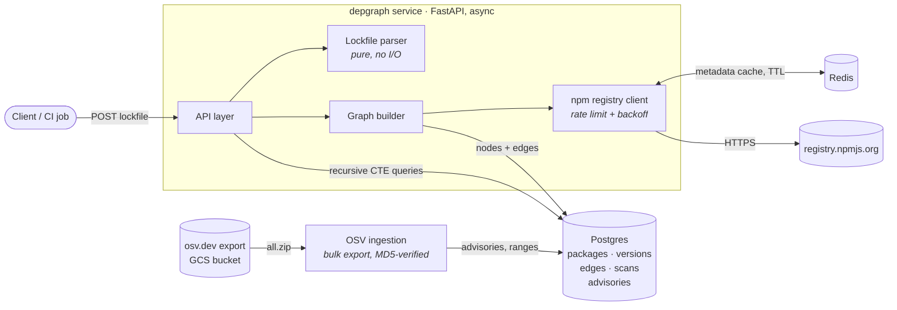
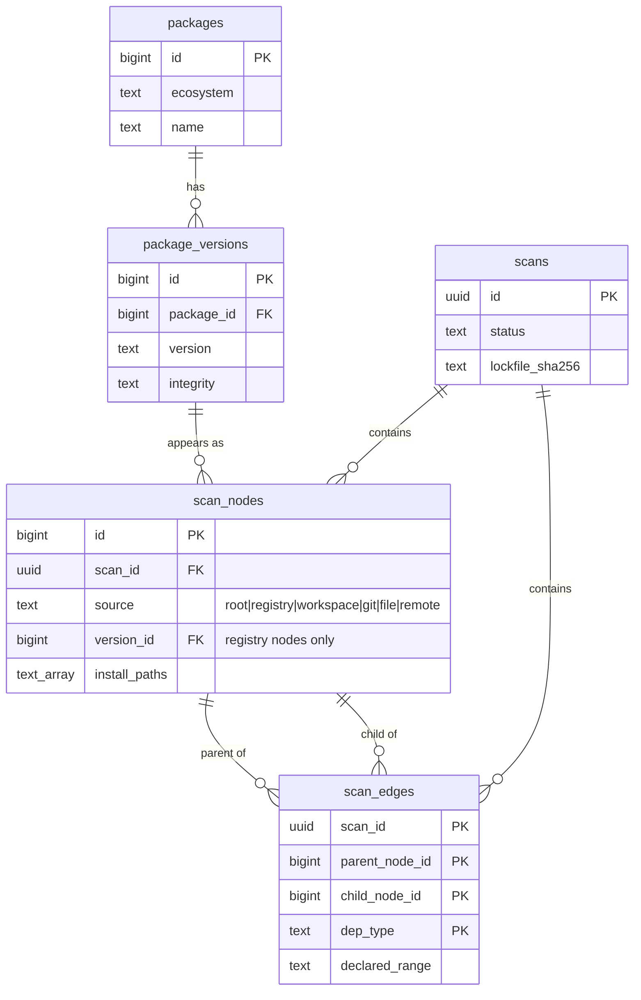

# depgraph

[](https://github.com/Aryav11111/depgraph/actions/workflows/ci.yml)


**depgraph turns a lockfile into a persisted, queryable map of every package your project actually ships.**

Upload a `package-lock.json` and depgraph resolves the full *transitive* dependency
graph (not just the 20 packages in your `package.json`, but the hundreds they pull in),
stores it in Postgres, and answers questions like *"through which chains of
dependencies does `minimist` end up in my build?"*

## Why

Most of a modern application's code is code you never chose directly. When a
package deep in the tree is compromised or vulnerable, the first questions are always
the same: *are we affected, which projects, and how did it get in?* Answering
them requires the resolved graph, persisted and indexed, which is the foundation
this project builds. Vulnerability matching, reachability analysis and a GitHub App
are planned later layers on top of it.

## Status

**Stage 1: lockfile → dependency graph** ✅

| Step | State |
|---|---|
| Scaffold: FastAPI, Postgres, Redis, Alembic, CI | ✅ |
| Schema for packages, versions, edges, scans | ✅ |
| `package-lock.json` parser (v2 + v3) | ✅ |
| npm registry client (rate limits, backoff, Redis cache) | ✅ |
| Graph builder (cycles, duplicate subtrees) | ✅ |
| Scan + graph + dependency-path API | ✅ |

**Stage 2: vulnerability and malicious-package detection** (in progress)

| Step | State |
|---|---|
| OSV advisory ingestion (bulk export; 230k npm records) | ✅ |
| Semver range matcher (incl. prereleases) | ✅ |
| Incremental sync worker | ⏳ next |
| Matching scans against advisories → findings | planned |
| Paths to each vulnerable package | planned |
| Fix suggestions (minimum safe version, direct vs transitive) | planned |
| Findings API | planned |

## Architecture



Design principles:

- **The parser is a pure function.** Lockfile in, typed graph out, with no database
  or network involved. That makes the trickiest logic the easiest to test exhaustively.
- **Async end to end.** FastAPI, SQLAlchemy 2.0 async with asyncpg, `redis.asyncio`, and
  `httpx`. Resolving a lockfile is I/O-bound fan-out (hundreds of registry lookups), which
  is exactly what async is good at.
- **Configuration only via environment variables**, validated at startup by
  pydantic-settings. No secrets in the repo.
- **Structured JSON logs** with a per-request `request_id` (honours incoming
  `X-Request-ID`), ready for Cloud Logging.

Design decisions and their trade-offs are recorded in [NOTES.md](NOTES.md).

## Data model



- **Global catalogue** (`packages`, `package_versions`): published npm versions are
  immutable, so each `name@version` is stored once and shared by every scan.
- **Per-scan graph** (`scan_nodes`, `scan_edges`): what a range *resolved to* is
  specific to one lockfile. Edges form an adjacency list, traversed with recursive
  CTEs. Cycles are allowed, and duplicate subtrees collapse into one node per
  `name@version`.
- Composite foreign keys mean an edge can never join nodes from two different scans.

## Running locally

Prerequisites: [Docker](https://docs.docker.com/get-docker/) and `make`. That's all:
tests, linting and migrations run in a `dev` container, so no local Python is needed.

```bash
cp .env.example .env
make up          # postgres + redis, runs migrations, starts the API on :8080
curl localhost:8080/health/ready
make test        # pytest inside the dev container, against the compose services
```

| Command | What it does |
|---|---|
| `make test` | pytest against the real Postgres/Redis (needs `make up`) |
| `make lint` / `make fmt` | ruff lint + format check / auto-fix |
| `make migrate` | apply Alembic migrations |
| `make revision m="..."` | autogenerate an Alembic migration |
| `make logs` / `make down` | tail API logs / stop the stack |

Prefer your host Python? Install [uv](https://docs.astral.sh/uv/), run `make install`,
and add `LOCAL=1` to any target (e.g. `make test LOCAL=1`).

All configuration is via env vars. See [.env.example](.env.example).

## API

Interactive docs are served at `/docs` (OpenAPI).

| Method | Path | Description |
|---|---|---|
| `POST` | `/scans` | Upload a `package-lock.json` (v2/v3) as the request body. It is parsed, resolved and stored; returns the scan (`201`). `422` for an invalid lockfile, `413` if too large. |
| `GET` | `/scans/{id}` | Scan status, counts and warnings (e.g. unresolved dependencies, integrity mismatches). |
| `GET` | `/scans/{id}/graph` | The full resolved graph: every package node and dependency edge. |
| `GET` | `/scans/{id}/paths?package=&version=&max_paths=&max_depth=` | Every dependency path from the project root to a package, shortest first, capped (`truncated` says if a cap was hit). |
| `GET` | `/health` | Liveness: the process is up. Never touches dependencies. |
| `GET` | `/health/ready` | Readiness: Postgres and Redis respond. Returns `503` with per-check detail otherwise. |

### Example

```bash
curl -s -X POST localhost:8080/scans -H 'Content-Type: application/json'      --data-binary @package-lock.json
# {"id":"1319d65f-...","status":"completed","node_count":385,"edge_count":570,"warnings":[],...}

curl -s 'localhost:8080/scans/1319d65f-.../paths?package=debug&version=2.6.9&max_paths=3'
```

Paths from that response, rendered (real output for the fixture in
`tests/fixtures/npm/realworld`):

```
acme-dashboard -> express@4.22.3 -> debug@2.6.9
acme-dashboard -> express@4.22.3 -> body-parser@1.20.8 -> debug@2.6.9
acme-dashboard -> express@4.22.3 -> finalhandler@1.3.2 -> debug@2.6.9
(truncated: more paths exist)
```

### How path queries stay fast on huge graphs

The number of distinct paths can grow exponentially (every "diamond" in the
graph doubles it). A recursive CTE first narrows the graph to the target's
ancestors; then a best-first (A*) search over that subgraph, ranked by
`path length so far + exact distance to the root`, yields paths **shortest
first** and does work proportional to the paths *returned*, not the paths that
exist. On a synthetic graph with 2³⁰ paths it returns the first 50 in
milliseconds.

## Project layout

```
src/depgraph/
  main.py          app factory + lifespan (connection pools)
  core/            settings, structured logging
  api/             routers, dependencies, request-context middleware
  db/              SQLAlchemy base, models, async session
  lockfile/        pure package-lock.json (v2/v3) parser
  registry/        npm registry client: rate limit, retry/backoff, Redis cache
  graph/           collapse install paths to identities; bulk persist + scan lifecycle
  advisories/      OSV normalization, CVSS v3 scoring, ingestion, semver + range matcher
migrations/        Alembic (async), URL taken from settings
tests/             pytest, in-process ASGI client against real services
  fixtures/npm/    real npm-generated lockfiles (+ the package.json they came from)
```

## Tech

Python 3.13 · FastAPI · SQLAlchemy 2.0 (async) + asyncpg · Alembic · PostgreSQL 17 ·
Redis 7.4 · httpx · structlog · pytest · ruff · uv · Docker Compose · GitHub Actions.
Deployment target: Google Cloud Run.
