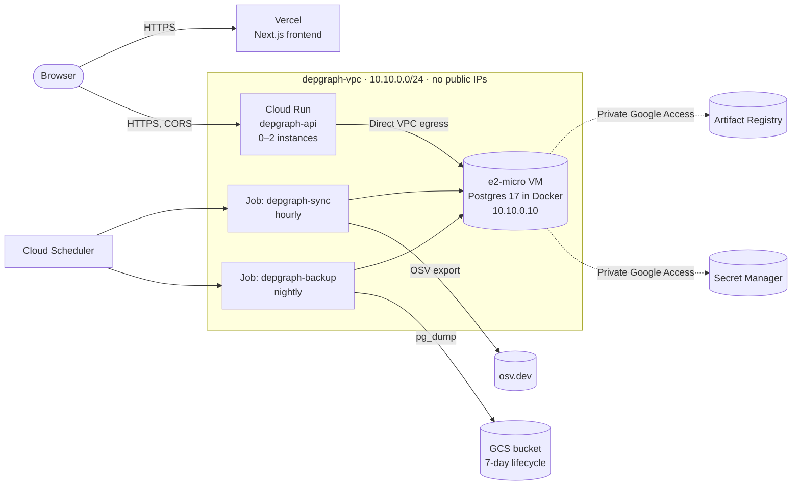

# Deploying depgraph (GCP + Vercel)

The API, its jobs and Postgres run on Google Cloud. The frontend runs on Vercel.
Everything is sized to stay inside the free tiers, so the expected cost is
**$0–0.10/month**. Budget alerts email you at $1 and $5.



| Resource | Config | Expected cost |
|---|---|---|
| Compute Engine `e2-micro` (us-central1) | Container-Optimized OS, no external IP; 10 GB boot + 20 GB data, standard disks | $0 (always free: 1 e2-micro + 30 GB standard disk) |
| Cloud Run service | scale to zero, max 2 instances, 512 MiB, request-based billing | $0 (free tier: 180k vCPU-s, 2M requests per month) |
| Cloud Run jobs | migrate (per deploy), sync (hourly), backup (nightly) | $0 (same free tier) |
| Cloud Scheduler | 2 jobs | $0 (3 free per billing account) |
| Artifact Registry | API, backup and Postgres images; keeps the 3 newest versions | ~$0–0.05 (0.5 GB free) |
| Cloud Storage | pg_dump of about 45 MB per night, kept 7 days, soft delete off | $0 (5 GB free) |
| Secret Manager | 1 secret (database password) | $0 (6 versions free) |
| Networking | Direct VPC egress (no connector), no NAT, no public IP on the VM | $0 |

**Worst case**, if the VM were somehow billed: about $7/month. The $1 budget
alert would catch that within a day.

## Prerequisites (you, once)

1. Install gcloud: `winget install Google.CloudSDK`. Then run `gcloud auth login`
   and `gcloud auth application-default login`.
2. Have a project with billing enabled: `gcloud projects create <id>`, then
   link billing in the console. Find your billing account with
   `gcloud billing accounts list`.
3. Have Docker running. The scripts build images locally and copy Postgres into
   Artifact Registry.
4. Have a Vercel account linked to GitHub.

## 1. Bootstrap (one time)

```sh
export PROJECT_ID=<id> BILLING_ACCOUNT=<XXXXXX-XXXXXX-XXXXXX>
infra/gcp/bootstrap.sh            # dry run: prints every command, changes nothing
infra/gcp/bootstrap.sh --apply    # creates what's missing; safe to re-run
```

The VM formats its data disk on first boot and starts Postgres. Watch it with:
`gcloud compute ssh depgraph-db --zone us-central1-a --tunnel-through-iap -- docker logs postgres`

## 2. Frontend on Vercel

Import the GitHub repo and set **Root Directory = `web`**. Add these
environment variables, all of them public build-time values:

| Name | Value |
|---|---|
| `NEXT_PUBLIC_API_URL` | the Cloud Run URL (printed at the end of deploy.sh) |
| `NEXT_PUBLIC_MAX_LOCKFILE_BYTES` | `5242880` |
| `NEXT_PUBLIC_SCAN_RETENTION_DAYS` | `7` |

Note the production URL (for example `https://depgraph.vercel.app`) and your
team slug: preview URLs look like `depgraph-<hash>-<team>.vercel.app`.

## 3. Deploy the API

```sh
export PROJECT_ID=<id> WEB_ORIGIN=https://depgraph.vercel.app VERCEL_TEAM=<team-slug>
infra/gcp/deploy.sh            # dry run
infra/gcp/deploy.sh --apply    # build + push images, migrate, deploy API and jobs
```

On the first deploy, also load the advisories now rather than waiting for the
hourly schedule. The first sync is a full load of about 230k records:

```sh
gcloud run jobs execute depgraph-sync --region us-central1 --wait
```

## 4. Verify

```sh
API=$(gcloud run services describe depgraph-api --region us-central1 --format 'value(status.url)')
curl -s $API/health/ready        # {"status":"ok","checks":{"postgres":"ok","redis":"disabled"}}

# Client IP check: a forged X-Forwarded-For entry must not change the bucket.
# Upload 11 times with a different forged value each time: the 11th must be 429.
for i in $(seq 1 11); do
  curl -s -o /dev/null -w "%{http_code} " -X POST $API/scans \
    -H "X-Forwarded-For: 192.0.2.$i" --data-binary @web/public/samples/acme-dashboard.json
done
```

If every request succeeds, the client IP is being taken from a forgeable
entry. In that case, look at the raw header in the request logs and adjust
`CLIENT_IP_PROXY_HOPS`.

## Operations

- **Restore a backup:** `gcloud storage cp gs://<bucket>/depgraph/<stamp>.dump .`,
  then run `pg_restore --clean --if-exists --no-owner -d depgraph <file>`
  through an IAP SSH tunnel to the VM.
- **OS updates:** recreate the VM from the latest `cos-stable` image. Data
  lives on `depgraph-pgdata`, which is never auto-deleted.
- **Rotate the password:** add a new secret version, then run `ALTER ROLE`
  on the VM and redeploy. The Postgres image reads the password file only at
  first initialisation.
- **Tear down:** delete the Cloud Run service and jobs, the scheduler jobs, the
  VM, the disk, the address, the bucket and the repository. Or delete the
  whole project.
